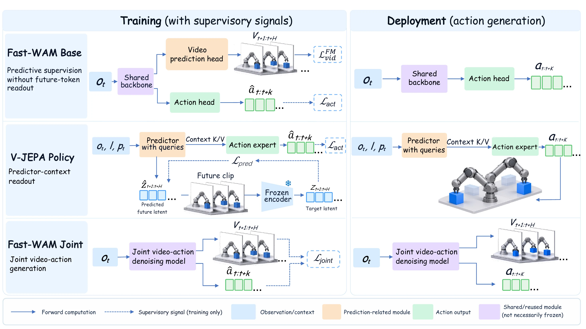

<div align="center">

# World Models for Physical AI

**Interfaces, Experimental Evidence, and Downstream Utility**

[Project website](https://dracoxa.github.io/World-Models-for-Physical-Survey/) · [Read the survey](docs/assets/survey.pdf) · [Evidence explorer](https://dracoxa.github.io/World-Models-for-Physical-Survey/explorer.html) · [Download evidence](docs/assets/Evidence-companion.zip)

面向物理智能的世界模型综述与实验证据浏览器

</div>

## When does prediction improve a physical decision?

A future prediction can supervise policy training, score candidate plans, guide action generation, evaluate a policy, or help revise actions during execution. The survey traces **what is predicted, how actions enter the model, and where the prediction is used**. Robotic manipulation anchors the quantitative analysis, with driving and navigation providing additional examples of how those interfaces differ.

<p align="center">
  <a href="https://dracoxa.github.io/World-Models-for-Physical-Survey/#findings">
    
  </a>
</p>

[Explore all seven figures](https://dracoxa.github.io/World-Models-for-Physical-Survey/#findings) · [Read the three proposed follow-up tests](https://dracoxa.github.io/World-Models-for-Physical-Survey/#tests)

## What the evidence shows

- **Training and deployment are separate places to test prediction.** In the Fast-WAM Base ablation, video co-training raises mean RoboTwin success from 83.8% to 91.8% while the deployed policy omits future-video generation. [Fast-WAM](https://arxiv.org/html/2603.16666v2#S4)
- **Offline metrics and closed-loop outcomes can rank methods differently.** For X-WAM on RoboCasa, GeoBoN's geometry scorer reaches 82.5% online success versus 77.4% with consensus, even though consensus ranks higher on the offline error-recovery metric. [GeoBoN, Table 3](https://arxiv.org/html/2607.17454v1#S4.SS4)
- **Simulator agreement and training utility answer different questions.** In DexTouch-WM, WM-Mix agrees more closely with evaluations of existing policies. In separate training experiments, WM-Robot's generated trajectories yield higher physical scores for two of three learners. [DexTouch-WM, Tables III–IV](https://arxiv.org/html/2609.20649v2#S4)

## Explore the data

| View | What you can inspect |
| --- | --- |
| [Evidence map](https://dracoxa.github.io/World-Models-for-Physical-Survey/explorer.html#evidence) | **75 selected studies and 93 extracted comparison records.** The extraction includes execution outcomes for 56 studies and 30 qualifying component-test records across 29 studies. The sensitivity check retains 26 studies after excluding four bundled records. |
| [RoboTwin 2.0](https://dracoxa.github.io/World-Models-for-Physical-Survey/explorer.html#benchmarks) | **1,650 clean/randomized task pairs across 33 configurations.** Mean success falls for 32 configurations after scene randomization. |
| [RoboDojo](https://dracoxa.github.io/World-Models-for-Physical-Survey/explorer.html#benchmarks) | **3,536 reported task-condition cells across 66 configurations.** Of those, 858 receive positive progress scores with zero task completion. |

The evidence map describes the studies selected by the survey. The benchmark views use the frozen November 10, 2026 snapshots and retain the evaluation unit of each benchmark.

## Downloads and citation

- [Survey PDF](docs/assets/survey.pdf) · [Line-numbered PDF](docs/assets/survey-review.pdf)
- [Evidence companion](docs/assets/Evidence-companion.zip) with source-linked comparison records, a workbook, and benchmark snapshots
- [Literature discovery catalogue](literature/current/README.md) · [CSV](literature/current/catalog.csv)

```bibtex
@misc{anonymous2026worldmodelsphysical,
  title  = {World Models for Physical AI: Interfaces, Experimental Evidence, and Downstream Utility},
  author = {{Anonymous Author(s)}},
  year   = {2026},
  url    = {https://dracoxa.github.io/World-Models-for-Physical-Survey/},
  note   = {Anonymous survey manuscript}
}
```

[Copy BibTeX on the project website](https://dracoxa.github.io/World-Models-for-Physical-Survey/#cite) · [Report a correction](https://github.com/Dracoxa/World-Models-for-Physical-Survey/issues/new)
