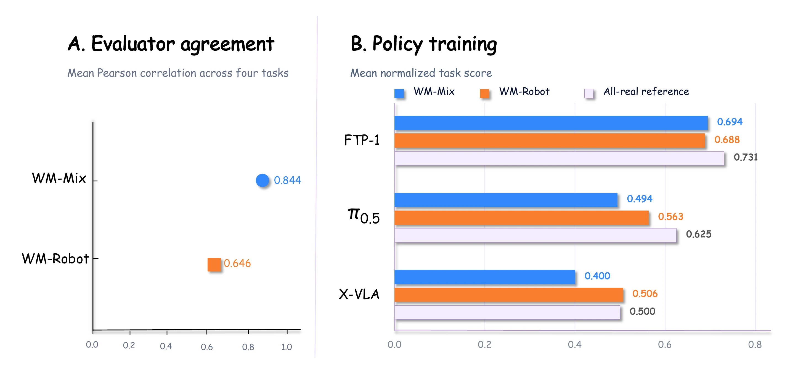
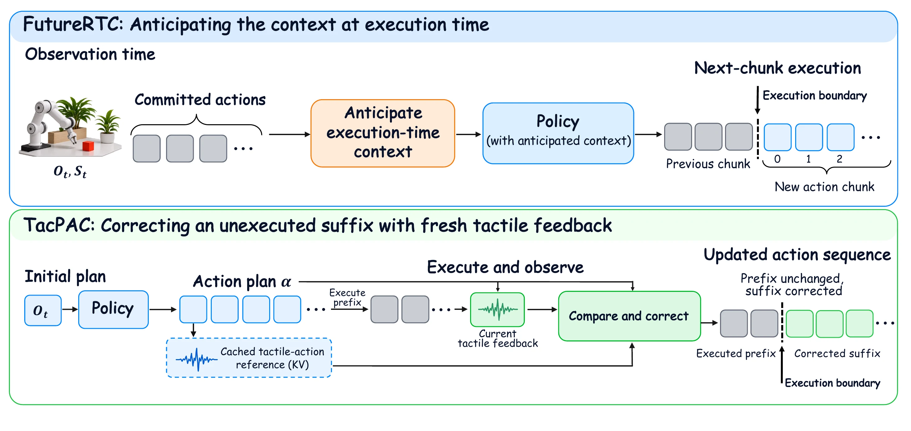

<div align="center">

# World Models for Physical AI

### Interfaces, Experimental Evidence, and Downstream Utility

*Auditing where learned environmental predictions enter Physical AI systems—and which controlled experiments actually establish downstream utility.*

<br>

[](https://dracoxa.github.io/World-Models-for-Physical-Survey/)
[](https://dracoxa.github.io/World-Models-for-Physical-Survey/explorer.html)
[](docs/assets/survey.pdf)
[](docs/assets/survey-review.pdf)
[](docs/assets/Evidence-companion.zip)

<p>
  <strong>English</strong> · <a href="README.zh-CN.md">简体中文</a>
  &nbsp;&nbsp;|&nbsp;&nbsp;
  <a href="#key-findings">Findings</a> ·
  <a href="#analytical-framework">Framework</a> ·
  <a href="#quantitative-evidence-audit">Evidence Audit</a> ·
  <a href="#task-level-benchmark-forensics">Benchmarks</a> ·
  <a href="#proposed-controlled-follow-up-tests">Open Tests</a> ·
  <a href="#figure-gallery">Figures</a> ·
  <a href="#citation">Citation</a>
</p>

<br>

<table>
  <tr>
    <td align="center" width="160"><strong>75</strong><br><sub>Core Studies</sub></td>
    <td align="center" width="160"><strong>93</strong><br><sub>Within-Study Controls</sub></td>
    <td align="center" width="160"><strong>1,650</strong><br><sub>RoboTwin 2.0 Pairs</sub></td>
    <td align="center" width="160"><strong>3,536</strong><br><sub>RoboDojo Eval Cells</sub></td>
    <td align="center" width="160"><strong>110</strong><br><sub>Verified References</sub></td>
  </tr>
</table>

<br>

<a href="https://dracoxa.github.io/World-Models-for-Physical-Survey/#findings">
  
</a>

<sub>
  <strong>Figure 4 (§3.3).</strong> Contrasting where future prediction enters computation: training-only supervision without future-token readout (<em>Fast-WAM Base</em>), predictor-context K/V readout (<em>V-JEPA Policy</em>), and joint video–action denoising (<em>Fast-WAM Joint</em>).
  <a href="https://dracoxa.github.io/World-Models-for-Physical-Survey/#findings">Explore all 7 figures ↗</a>
</sub>

</div>

<br>

> [!IMPORTANT]
> **Core Question:** Learned world models predict how physical environments evolve, yet **higher forecast fidelity does not automatically improve physical behavior**. Forecasts enter Physical AI through five distinct interfaces—**training supervision**, **candidate-plan scoring**, **action-generation context**, **offline policy evaluation**, and **runtime correction**—and each role demands its own experimental control.
>
> Quantitatively anchored in **robotic manipulation** with **autonomous driving** and **navigation** as cross-domain interface contrasts, this survey pairs an experiment-level attribution audit (**75 studies / 93 comparisons**) with task-level forensics of frozen **RoboTwin 2.0** and **RoboDojo** leaderboards.

---

## Key Findings

| Interface | Empirical Contrast | Source Anchor |
| :--- | :--- | :--- |
| **Training Supervision** *(§3.1)* | **Training-time future supervision aids policy learning even when deployment omits future generation.** Removing video co-training from *Fast-WAM Base* lowers mean RoboTwin success from **91.8% to 83.8%** (`−8.0 pp`) while holding deployment inference fixed (`190 ms` vs. `810 ms` for explicit IDM generation). Consistent gains appear in *DyPES-VLA* and *Cosmos Policy*. | [Fast-WAM v2 §4](https://arxiv.org/html/2603.16666v2#S4) · [DyPES-VLA](https://arxiv.org/abs/2608.06374) |
| **Candidate-Plan Scoring** *(§3.2)* | **Offline ranking and closed-loop execution can reverse—and candidate pools bound selection headroom.** On RoboCasa (*X-WAM*, $K=8$), consensus scoring leads offline trajectory-error recovery (**8.6% vs. 6.9%**) yet reverses in closed loop (**77.4% vs. 82.5%** for *GeoBoN* geometric scoring). In *Yuan et al.*, only **6 of 48** restored states have mixed outcomes; in *ContactWorld*, lowest 6-step recursive error (*TacRGB*) differs from highest closed-loop planning mean (*TacFF*). | [GeoBoN Table 3](https://arxiv.org/html/2607.17454v1#S4.SS4) · [Yuan et al.](https://arxiv.org/abs/2609.24745) · [ContactWorld](https://arxiv.org/abs/2606.13877) |
| **Offline Policy Evaluation** *(§3.4)* | **Higher agreement with existing policies does not guarantee better training outcomes for new learners.** In *DexTouch-WM*, `WM-Mix` raises mean evaluator correlation from **0.646 to 0.844** (Table III), yet yields lower recomputed physical training means than `WM-Robot` for two of three learners (**0.494 vs. 0.563** on $\pi_{0.5}$; **0.400 vs. 0.506** on X-VLA, Table IV). | [DexTouch-WM Tables III–IV](https://arxiv.org/html/2609.20649v2#S4) · [IWS](https://arxiv.org/abs/2603.08546) |
| **Runtime Correction** *(§3.5)* | **Timing windows and net completion across all attempts govern runtime utility.** *FutureRTC* shows action-index alignment shifting LIBERO success from **96.6% to 0.9%** under fixed oracle context; *TacPAC* lifts physical success from **47% to 64%** via cached tactile suffix revision (with `1.6%` step overlap); *VLA-FixBench* shows automatic intervention can drop net completion to **0–25%** vs. **30%** unassisted. | [FutureRTC](https://arxiv.org/abs/2607.24008) · [TacPAC](https://arxiv.org/abs/2609.05266) · [VLA-FixBench](https://proceedings.mlr.press/v306/yan26r.html) |

---

## Analytical Framework

Rather than grouping papers solely by generative backbone, the survey locates every model along three axes—**Prediction Target ($y$)**, **Action Interface** ($p_\theta(y_{t+1:t+H}\mid h_t, a_{t:t+H-1})$ vs. goal-conditioned / joint / passive), and **Downstream Use**—and matches claims to six evidence dimensions (**L1–L6**):

<table>
  <thead>
    <tr>
      <th align="left">Section</th>
      <th align="left">Scope &amp; Questions Addressed</th>
      <th align="left">Key Tables &amp; Figures</th>
    </tr>
  </thead>
  <tbody>
    <tr>
      <td><strong>§1 · Foundations &amp; Scope</strong></td>
      <td>Running grasp contrast (Fast-WAM Base vs. GeoBoN), 3 axes, Eq. (1), L1–L6 ladder, purposive-selection protocol, and positioning against 7 recent 2026 surveys.</td>
      <td>Table 1 · Figs. 1–2</td>
    </tr>
    <tr>
      <td><strong>§2 · Information Requirements</strong></td>
      <td>Command–consequence grounding, task state initialization &amp; recursive rollout stability, observation history, viewpoint consistency, and embodiment transfer.</td>
      <td>Table 2 · Fig. 3</td>
    </tr>
    <tr>
      <td><strong>§3 · Learning, Planning &amp; Action</strong></td>
      <td>Interface-by-interface audit across policy learning (§3.1), candidate planning (§3.2, Eq. 2), action generation (§3.3), policy evaluation (§3.4), and runtime safety (§3.5).</td>
      <td>Tables 3–6 · Figs. 4–6</td>
    </tr>
    <tr>
      <td><strong>§4 · Utility, Forensics &amp; Open Tests</strong></td>
      <td>Frozen RoboTwin 2.0 &amp; RoboDojo task-level forensics, 75-study / 93-comparison attribution funnel, synthesis, and three falsifiable controlled follow-up tests.</td>
      <td>Tables 7–10 · Fig. 7</td>
    </tr>
  </tbody>
</table>

**Claim-Matched Evaluation Ladder (L1–L6, §1.2):**

| Level | Dimension | What It Verifies | Why It Cannot Substitute for Higher Levels |
| :---: | :--- | :--- | :--- |
| **L1** | Perceptual fidelity | Visual coherence of predicted frames | Plausible frames can still misplace objects or contacts |
| **L2** | Physical state | Dynamics, geometry, or contact state error | Lower 1-step or rollout error does not ensure planner gain |
| **L3** | Action realization | Predicted robot motion follows supplied commands | Moving fingers accurately does not guarantee object response |
| **L4** | Interaction grounding | Realized motion produces correct object/contact response | Accurate local interaction does not isolate closed-loop selection |
| **L5** | Downstream policy utility | Closed-loop task completion under a defined consumer | Offline proxy ranking or evaluator correlation can reverse online |
| **L6** | Operational reliability | Deadline compliance, recovery, and net completion | Alarm discrimination or conditional recovery can lower net success |

---

## Quantitative Evidence Audit

Every extracted comparison in our **75-study / 93-comparison** ledger is anchored to a pinned paper version, exact table/section locator, experimental arms, outcomes, and co-varying factors.

### Table 9 — Evidence Coverage Across Predictive Uses

| Use Examined | Core Papers | Execution Outcome | Component Test *(Strict)* | Illustrative Endpoint &amp; Finding |
| :--- | :---: | :---: | :---: | :--- |
| **Predictive representation** | 10 | 0 | 0 | *GNS* (L2): intermediate noise yields best recursive rollout while worsening clean 1-step fit |
| **Policy training** | **26** | **24** | **14** | *Fast-WAM Base* (L5): RoboTwin mean rises `83.8% → 91.8%` with training-only video supervision |
| **Planning and selection** | 16 | 13 | 9 | *GeoBoN* (L5): RoboCasa ($K=8$) closed-loop `82.5%` geometric vs. `77.4%` consensus (`80.8%` at $K=1$) |
| **Action generation** | 21 | 18 | **4 (2)** | *OmniVTA* (L5): future vision shifts wiping `66% → 70%`, peeling `40% → 38%`, latency `230 → 480 ms` |
| **Assessment** | 7 | 0 | 0 | *DexTouch-WM* (Eval. L5): mean Pearson $r = 0.844$ (`WM-Mix`) vs. `0.646` (`WM-Robot`) |
| **Execution &amp; intervention** | 6 | 6 | **2 (1)** | *TacPAC* (L5): cached tactile predictions lift 5-task physical mean `47% → 64%` (`1.6%` step overlap) |
| **Any use (deduplicated)** | **75** | **56** | **29 (26)** | **30 qualifying component records: 21 improve · 8 mixed · 1 worsens** |

> [!NOTE]
> **Coding & Scope Boundaries (§1.3, §4.4):** Counts reflect the **22 November 2026** purposively selected corpus rather than field-wide prevalence. Parenthetical counts exclude **four bundled records across three studies** (*NavForesee*, *NavThinker*, *DreamAvoid*), shrinking Action generation (`4 → 2`) and Execution &amp; intervention (`2 → 1`). In this corpus, **closed-loop autonomous driving component tests = 0**.
>
> 👉 **[Filter all 93 comparisons interactively in the Evidence Explorer →](https://dracoxa.github.io/World-Models-for-Physical-Survey/explorer.html#evidence)**

---

## Task-Level Benchmark Forensics

To test what aggregate leaderboard scores conceal about complete systems—without conflating system-level protocol differences with isolated predictor effects—we independently re-analyze the frozen **10 November 2026** snapshots of **RoboTwin 2.0** and **RoboDojo**:

| Benchmark (Frozen 2026-11-10) | Scope Analyzed | Headline Finding | Concrete Example | Interactive View |
| :--- | :--- | :--- | :--- | :--- |
| **RoboTwin 2.0** *(§4.2, Table 7)* | **33** configurations × 50 bimanual tasks = **1,650** matched clean/randomized pairs (`28` co-trained + `5` single-task) | Mean success drops in **32 / 33** configs (**27 / 28** co-trained); **12** configs (**11** co-trained) decline on **all 50 tasks**. | *Fast-WAM* drops `75.84 pp` mean (`84.50 pp` median); even sole mean-gainer *GigaBrain-0.7* (`+1.12 pp`) still drops on **18 tasks**. | [Inspect 33 Configs ↗](https://dracoxa.github.io/World-Models-for-Physical-Survey/explorer.html#benchmarks) |
| **RoboDojo** *(§4.3, Table 8)* | **66** simulation configs, **3,536** visible task–condition cells (`28` missing) + **14** real-robot submissions | **Every config (66 / 66)** has positive-Score, zero-SR cells (median **13**, range `3–26`); **858 / 3,536 cells (24.3%)** credit partial progress despite `0%` completion. | *VPP2* on `organize_table` scores **63.17** progress with only **7.33%** SR; *WALL-OSS-1.0-lite* matches *VPP2* on Memory (`56.00% vs. 55.56%`) with higher overall SR (`34.97% vs. 32.26%`). | [Inspect 66 Configs ↗](https://dracoxa.github.io/World-Models-for-Physical-Survey/explorer.html#benchmarks) |

---

## Proposed Controlled Follow-Up Tests

Translating the evidence gaps from §3–§4 into actionable, falsifiable experimental protocols (**Table 10, §4.5**):

| Proposed Test | Fixed Controls | Varied Intervention | Required Outcomes &amp; Falsification Criterion |
| :--- | :--- | :--- | :--- |
| **1. Physical same-state branching** *(L5)* | Restored scene, randomized branch order, candidate pool, continuation policy, search budget | Candidate scoring rule | Primary: all-starts terminal completion diff + mixed-outcome diagnostic + $K=1$ reference + latency. Must beat equal-budget uniform selection at acceptable latency. |
| **2. Dynamics swap for contact planning** *(L2, L4, L5)* | Sensors, **frozen encoder**, shared state space, goal cost, search budget, replanning rule | Predictive dynamics | Rollout error, observed object response, closed-loop completion, planning latency. Lower rollout error alone establishes only an L2 fidelity gain, not L5 planning utility. |
| **3. Runtime access to predicted contact** *(L5, L6)* | Observations, base chunk &amp; action index, compute budget, editable window &amp; hard deadline | Access to cached predictive reference | Net completion **across all attempts** (including late updates), latency, missed-deadline rate, and multi-seed uncertainty. Net gains below prespecified threshold count against runtime predictive access. |

---

## Figure Gallery

<table>
  <tr>
    <td width="50%" align="center" valign="top">
      <a href="docs/assets/figure-05.pdf">
        
      </a>
      <br><sub><strong>Fig. 5 (§3.4).</strong> Evaluator agreement vs. recomputed training scores in <em>DexTouch-WM</em>. <a href="docs/assets/figure-05.pdf">Vector PDF ↗</a></sub>
    </td>
    <td width="50%" align="center" valign="top">
      <a href="docs/assets/figure-06.pdf">
        
      </a>
      <br><sub><strong>Fig. 6 (§3.5).</strong> Execution-time anticipation (<em>FutureRTC</em>) vs. suffix correction (<em>TacPAC</em>). <a href="docs/assets/figure-06.pdf">Vector PDF ↗</a></sub>
    </td>
  </tr>
</table>

<details>
<summary><strong>Browse all 7 manuscript figures (click to expand)</strong></summary>

<br>

| Figure | Section &amp; Description | Preview &amp; Vector PDF |
| :---: | :--- | :--- |
| **Fig. 1** | **§1.2 · Four-Part Survey Organization.** Traces predictive systems across foundations, data/representations, learning/decisions, and evaluation/reliability. | [WebP](docs/assets/figure-01.webp) · [Vector PDF](docs/assets/figure-01.pdf) |
| **Fig. 2** | **§1.2 · Thematic Landscape.** Situates modern world models alongside direct action policies, datasets (OXE), and benchmarks (LIBERO, CALVIN, RLBench, ManiSkill). | [WebP](docs/assets/figure-02.webp) · [Vector PDF](docs/assets/figure-02.pdf) |
| **Fig. 3** | **§2 · Data, Representations &amp; Generalization.** Maps robot demonstrations, human videos, simulation, and generated data to representations, uses, and shift regimes. | [WebP](docs/assets/figure-03.webp) · [Vector PDF](docs/assets/figure-03.pdf) |
| **Fig. 4** | **§3.3 · Training vs. Deployment Information Paths.** Compares *Fast-WAM Base*, *V-JEPA Policy*, and *Fast-WAM Joint* across training supervision and deployment readout. | [WebP](docs/assets/figure-04.webp) · [Vector PDF](docs/assets/figure-04.pdf) |
| **Fig. 5** | **§3.4 · Evaluator Agreement vs. Training Utility.** Side-by-side comparison of *DexTouch-WM* Table III correlations (`0.844 vs. 0.646`) and Table IV training means. | [WebP](docs/assets/figure-05.webp) · [Vector PDF](docs/assets/figure-05.pdf) |
| **Fig. 6** | **§3.5 · Editable Action Windows at Runtime.** Schematic contrast of context anticipation (*FutureRTC*) and cached tactile suffix revision (*TacPAC*). | [WebP](docs/assets/figure-06.webp) · [Vector PDF](docs/assets/figure-06.pdf) |
| **Fig. 7** | **§4.4 · From Design to Claim-Matched Evidence.** Synthesizes recursive fidelity vs. planning, evaluator vs. training, and anticipation vs. correction contrasts. | [WebP](docs/assets/figure-07.webp) · [Vector PDF](docs/assets/figure-07.pdf) |

</details>

---

## Repository Structure &amp; Downloads

```text
World-Models-for-Physical-Survey/
├── docs/                           # Companion website & interactive 93-comparison explorer (GitHub Pages)
│   ├── index.html                  # Editorial overview, interactive Table 9 toggle & 7-figure viewer
│   ├── explorer.html               # Searchable 93-comparison table + RoboTwin (33) & RoboDojo (66) forensics
│   ├── check_site.py               # Automated integrity check for HTML anchors, 7 figures, and JSON counts
│   └── assets/                     # Survey PDFs, WebP/PNG/PDF figures, Evidence-companion.zip & JSON data
├── literature/
│   └── current/                    # Discovery catalogue (README.md + catalog.csv) & structured literature index
├── paper/                          # Manuscript source tree
├── README.md                       # English repository homepage
└── README.zh-CN.md                 # Simplified Chinese repository homepage (简体中文版)
```

### Direct Downloads

- **Manuscript (Typeset Preview, 34 pp):** [docs/assets/survey.pdf](docs/assets/survey.pdf)
- **Manuscript (Line-Numbered Review Copy, 31 pp):** [docs/assets/survey-review.pdf](docs/assets/survey-review.pdf)
- **Evidence Companion Archive:** [docs/assets/Evidence-companion.zip](docs/assets/Evidence-companion.zip) — source-linked 93-comparison ledger, quantitative workbook, and frozen benchmark snapshots
- **Literature Discovery Catalogue:** [literature/current/README.md](literature/current/README.md) · [catalog.csv](literature/current/catalog.csv)

---

## Citation

If you find this survey, its evidence ledger, or the benchmark forensics useful in your research, please cite:

```bibtex
@misc{anonymous2026worldmodelsphysical,
  title  = {World Models for Physical AI: Interfaces, Experimental Evidence, and Downstream Utility},
  author = {{Anonymous Author(s)}},
  year   = {2026},
  url    = {https://dracoxa.github.io/World-Models-for-Physical-Survey/},
  note   = {Anonymous survey manuscript}
}
```

<div align="center">

[Copy BibTeX on Project Website](https://dracoxa.github.io/World-Models-for-Physical-Survey/#cite) · [Open Interactive Explorer](https://dracoxa.github.io/World-Models-for-Physical-Survey/explorer.html) · [Report a Correction or Missing Study](https://github.com/Dracoxa/World-Models-for-Physical-Survey/issues/new)

</div>
