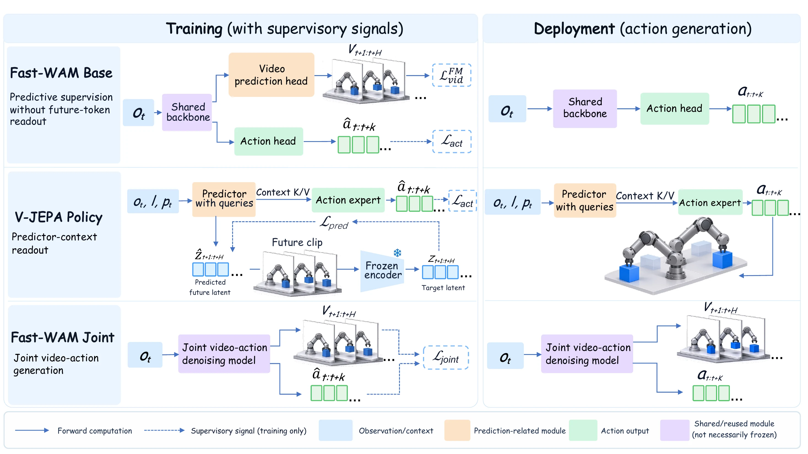
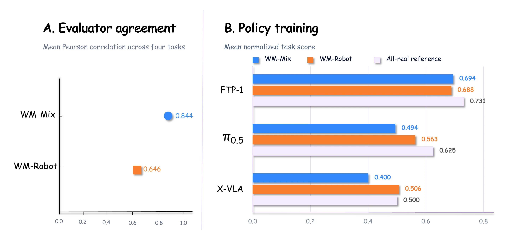
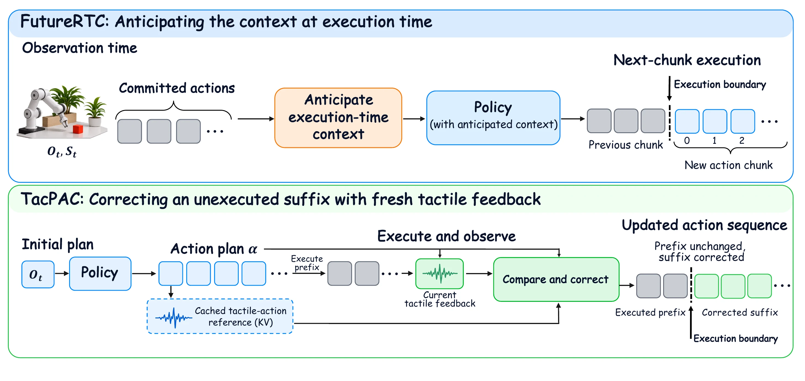

<div align="center">

# 面向物理智能的世界模型

### 接口、实验证据与下游效用

*系统审计学到的环境预测究竟通过哪一接口进入 Physical AI 系统，以及什么样的受控实验才能真正证明其下游物理效用。*

<br>

<p>
  <a href="https://dracoxa.github.io/World-Models-for-Physical-Survey/"></a>&nbsp;
  <a href="https://dracoxa.github.io/World-Models-for-Physical-Survey/explorer.html"></a>&nbsp;
  <a href="docs/assets/survey.pdf"></a>&nbsp;
  <a href="docs/assets/survey-review.pdf"></a>&nbsp;
  <a href="docs/assets/Evidence-companion.zip"></a>
</p>

<p>
  <a href="https://github.com/Dracoxa/World-Models-for-Physical-Survey">English</a> · <strong>简体中文</strong>
  &nbsp;&nbsp;|&nbsp;&nbsp;
  <a href="#核心发现">核心发现</a> ·
  <a href="#分析框架与全文路线图">分析框架</a> ·
  <a href="#定量证据审计表-9">证据审计</a> ·
  <a href="#公开榜单逐任务取证">榜单取证</a> ·
  <a href="#三项可证伪受控实验表-10">拟议实验</a> ·
  <a href="#论文插图一览">插图一览</a> ·
  <a href="#引用方式">引用</a>
</p>

<br>

<table>
  <tr>
    <td align="center" width="160"><strong>75 篇</strong><br><sub>核心精读研究</sub></td>
    <td align="center" width="160"><strong>93 条</strong><br><sub>原论文内对照</sub></td>
    <td align="center" width="160"><strong>1,650 对</strong><br><sub>RoboTwin 2.0 配对</sub></td>
    <td align="center" width="160"><strong>3,536 格</strong><br><sub>RoboDojo 评测单元</sub></td>
    <td align="center" width="160"><strong>110 篇</strong><br><sub>逐条核验参考文献</sub></td>
  </tr>
</table>

<br>

<a href="https://dracoxa.github.io/World-Models-for-Physical-Survey/#findings">
  
</a>

<sub>
  <strong>图 4（§3.3）：</strong>对比未来预测介入计算的不同路径——仅训练期监督且部署跳过未来生成（<em>Fast-WAM Base</em>）、动作专家读取预测器上下文 K/V（<em>V-JEPA Policy</em>），以及视频—动作联合去噪（<em>Fast-WAM Joint</em>）。
  <a href="https://dracoxa.github.io/World-Models-for-Physical-Survey/#findings">在线浏览全部 7 张插图 ↗</a>
</sub>

</div>

<br>

> [!IMPORTANT]
> **核心追问：** 学习到的世界模型能够预测物理环境的演化，但**更高的预测保真度（forecast fidelity）并不会自动转化为更好的物理执行表现（downstream physical utility）**。预测结果通过五类截然不同的计算接口进入 Physical AI 系统——**训练监督、候选规划打分、动作生成条件、离线策略评估、运行时纠偏**——每一类角色都需要相匹配的受控实验来验证。
>
> 本综述以**机器人操作（robotic manipulation）为定量锚点**，以**自动驾驶**与**导航**作为跨领域接口对照，将实验级微观归因账本（**75 篇核心研究 / 93 条同文对照**）与冻结快照下的 **RoboTwin 2.0**、**RoboDojo** 逐任务榜单取证并行结合。

---

## 核心发现

| 预测接口 | 关键实证反差 | 原文定位 |
| :--- | :--- | :--- |
| **训练期监督** *（§3.1）* | **即便部署时完全跳过未来生成，训练期的未来预测监督仍能稳定提升策略学习。** *Fast-WAM Base* 移除视频联合训练后，RoboTwin 平均成功率从 **91.8% 降至 83.8%**（`−8.0 pp`），而部署推理路径保持不变（延迟 `190 ms`，对比显式生成的 IDM `810 ms`）；*DyPES-VLA* 与 *Cosmos Policy* 亦呈一致趋势。 | [Fast-WAM v2 §4](https://arxiv.org/html/2603.16666v2#S4) · [DyPES-VLA](https://arxiv.org/abs/2608.06374) |
| **候选规划打分** *（§3.2）* | **离线拟合与闭环执行排序可能反转，且候选池本身限制了重排上限。** 在 RoboCasa（*X-WAM*，<i>K</i> = 8）上，共识打分在离线轨迹误差恢复上占优（**8.6% vs. 6.9%**），进入闭环后却反转为 *GeoBoN* 几何打分领先（**82.5% vs. 77.4%**）。*Yuan et al.* 中 48 个恢复状态仅 **6 个**存在混合结果；*ContactWorld* 中 6 步递归误差最低表征（*TacRGB*）与闭环规划均分最高表征（*TacFF*）并不一致。 | [GeoBoN 表 3](https://arxiv.org/html/2607.17454v1#S4.SS4) · [Yuan et al.](https://arxiv.org/abs/2609.24745) · [ContactWorld](https://arxiv.org/abs/2606.13877) |
| **离线策略评估** *（§3.4）* | **对已有策略评估更一致的模拟器，拿来训练新学习器时表现可能反而更差。** 在 *DexTouch-WM* 中，`WM-Mix` 将四任务评估平均相关性从 **0.646 提升至 0.844**（表 III），但在另一组重训实验中，其在三类学习器中的两类上重算真机均分低于 `WM-Robot`（π<sub>0.5</sub>：**0.494 vs. 0.563**；X-VLA：**0.400 vs. 0.506**，表 IV）。 | [DexTouch-WM 表 III–IV](https://arxiv.org/html/2609.20649v2#S4) · [IWS](https://arxiv.org/abs/2603.08546) |
| **运行时纠偏** *（§3.5）* | **运行时价值取决于更新能否赶在动作锁死前到达，以及全样本净完成率是否提高。** *FutureRTC* 表明理想上下文下动作索引对齐可令 LIBERO 成功率从 **96.6% 跌至 0.9%**；*TacPAC* 借缓存预测触觉修订未执行后缀，将 5 项真机均分从 **47% 提至 64%**（`1.6%` 调用与步进重叠）；*VLA-FixBench* 显示自动干预可将净完成率拉低至 **0–25%**（低于无干预的 **30%**）。 | [FutureRTC](https://arxiv.org/abs/2607.24008) · [TacPAC](https://arxiv.org/abs/2609.05266) · [VLA-FixBench](https://proceedings.mlr.press/v306/yan26r.html) |

---

## 分析框架与全文路线图

本综述不按“扩散 / 自回归 / 潜变量”架构堆砌论文，而是沿着三条正交轴——**预测目标（<i>y</i>）**、**动作接口**（<i>p</i><sub>θ</sub>(<i>y</i><sub><i>t</i>+1:<i>t</i>+<i>H</i></sub> | <i>h</i><sub><i>t</i></sub>, <i>a</i><sub><i>t</i>:<i>t</i>+<i>H</i>−1</sub>) 对比目标条件 / 联合 / 被动预测）与**下游消费者**——展开，并将实验主张严格对齐到 **L1–L6 六级评测标尺**：

<table>
  <thead>
    <tr>
      <th align="left">章节</th>
      <th align="left">核心内容与研究问题</th>
      <th align="left">对应图表</th>
    </tr>
  </thead>
  <tbody>
    <tr>
      <td><strong>§1 · 基础与范围</strong></td>
      <td>以 Fast-WAM Base 与 GeoBoN 对比破题；确立三轴框架、公式 (1)、L1–L6 标尺、目的抽样透明声明，并与 7 篇 2026 年最新综述对标。</td>
      <td>表 1 · 图 1–2</td>
    </tr>
    <tr>
      <td><strong>§2 · 下游控制的信息前提</strong></td>
      <td>指令—后果绑定、任务状态初始化与多步递归滚动稳定性、观测历史窗口、跨视角动作一致性及跨本体迁移接口。</td>
      <td>表 2 · 图 3</td>
    </tr>
    <tr>
      <td><strong>§3 · 预测进入学习与行动</strong></td>
      <td>按五大接口逐一审计：策略学习（§3.1）、候选规划（§3.2，公式 2）、动作生成（§3.3）、离线策略评估（§3.4）与运行时安全（§3.5）。</td>
      <td>表 3–6 · 图 4–6</td>
    </tr>
    <tr>
      <td><strong>§4 · 定量复算、归因与实验规范</strong></td>
      <td>RoboTwin 2.0 与 RoboDojo 逐任务取证、75 篇/93 条对照归因漏斗、综合结论与三项可证伪受控后续实验。</td>
      <td>表 7–10 · 图 7</td>
    </tr>
  </tbody>
</table>

**主张匹配的六级评测标尺（L1–L6，§1.2）：**

| 等级 | 评测维度 | 检验内容 | 为何不能替代更高等级 |
| :---: | :--- | :--- | :--- |
| **L1** | 感知保真度 | 生成画面的视觉连贯性与逼真度 | 画面逼真仍可能画错物体位置或接触细节 |
| **L2** | 物理状态 | 动力学、几何或接触状态误差 | 单步或滚动误差更低不代表闭环规划更优 |
| **L3** | 动作实现 | 预测中的机械臂运动是否遵循给定指令 | 手指轨迹准确不保证物体按物理规律响应 |
| **L4** | 交互落地 | 运动是否引发正确的物体位移或接触反馈 | 局部交互准确仍未验证闭环动作选择收益 |
| **L5** | 下游策略效用 | 指定消费者与协议下的闭环任务完成率 | 离线代理排序或评估器相关性可能在闭环反转 |
| **L6** | 运行可靠性 | 截止时间达标、故障恢复与全样本净完成率 | 报警判别或局部条件恢复可能拉低整体净成功率 |

---

## 定量证据审计（表 9）

本综述的 **75 篇核心研究 / 93 条同文对照**账本中，每一条记录均锚定至固定文献版本、具体表格或章节定位、对比组设置、结果与同步变化的混杂因素。

| 检验用途 | 核心论文数 | 含执行结果 | 合格组件测试 *（去捆绑）* | 代表性终点指标与结果 |
| :--- | :---: | :---: | :---: | :--- |
| **预测表征** | 10 | 0 | 0 | *GNS*（L2）：适度训练噪声恶化单步拟合，却带来最稳多步递归滚动 |
| **策略训练** | **26** | **24** | **14** | *Fast-WAM Base*（L5）：仅保留训练期视频监督使 RoboTwin 均分 `83.8% → 91.8%` |
| **规划与选择** | 16 | 13 | 9 | *GeoBoN*（L5）：RoboCasa（<i>K</i> = 8）闭环几何打分 `82.5%` vs. 共识 `77.4%`（<i>K</i> = 1 为 `80.8%`） |
| **动作生成** | 21 | 18 | **4 (2)** | *OmniVTA*（L5）：加入未来视觉后擦拭 `66% → 70%`、削皮 `40% → 38%`，延迟 `230 → 480 ms` |
| **策略评估** | 7 | 0 | 0 | *DexTouch-WM*（Eval. L5）：平均 Pearson <i>r</i> = 0.844（`WM-Mix`）vs. `0.646`（`WM-Robot`） |
| **执行与运行时干预** | 6 | 6 | **2 (1)** | *TacPAC*（L5）：读取缓存预测触觉使 5 项真机均分 `47% → 64%`（`1.6%` 步进重叠） |
| **任意用途（去重总计）** | **75** | **56** | **29 (26)** | **30 条合格组件记录：21 条提升 · 8 条混合 · 1 条变差** |

> [!NOTE]
> **编码与范围边界（§1.3、§4.4）：** 以上统计刻画截至 **2026 年 11 月 22 日**的目的抽样语料库，而非对全领域占比的估计。括号内数字为敏感性复核中排除 **3 篇研究内的 4 条捆绑记录**（*NavForesee*、*NavThinker*、*DreamAvoid*）后的结果，动作生成缩至 `2` 篇、运行时干预缩至 `1` 篇；本语料中**自动驾驶闭环组件测试为 0 篇**。
>
> 👉 **[在交互式证据浏览器中筛选全部 93 条对照记录 →](https://dracoxa.github.io/World-Models-for-Physical-Survey/explorer.html#evidence)**

---

## 公开榜单逐任务取证

为检验聚合总分与进度分掩盖的完整系统短板（同时避免将系统级协议差异误归因给预测模块），我们对冻结于 **2026 年 11 月 10 日**的 **RoboTwin 2.0** 与 **RoboDojo** 原始快照进行了独立逐任务复算：

| 公开基准（2026-11-10 快照） | 复算范围 | 核心发现 | 典型案例 | 交互视图 |
| :--- | :--- | :--- | :--- | :--- |
| **RoboTwin 2.0** *（§4.2，表 7）* | **33** 个配置 × 50 双臂任务 = **1,650** 组同任务干净/随机化配对（`28` 共训 + `5` 单任务） | 场景随机化后 **32 / 33** 个配置均分下降（共训 **27 / 28**）；**12** 个配置（`11` 共训）在**全部 50 个任务上均下降**。 | *Fast-WAM* 均值降 `75.84 pp`（中位数降 `84.50 pp`）；唯一均分微涨的 *GigaBrain-0.7*（`+1.12 pp`）仍有 **18 个任务下降**。 | [查看 33 个配置 ↗](https://dracoxa.github.io/World-Models-for-Physical-Survey/explorer.html#benchmarks) |
| **RoboDojo** *（§4.3，表 8）* | **66** 个仿真配置、**3,536** 个可见任务条件单元格（`28` 缺失）+ **14** 个真机提交 | **全部 66 / 66 个配置**均存在“正进度分、零完成率”单元（中位数 **13** 个，范围 `3–26`）；**858 / 3,536 格（24.3%）** 获进度分但完成率为 `0%`。 | *VPP2* 在 `organize_table` 上进度分高达 **63.17**，完成率仅 **7.33%**；*WALL-OSS-1.0-lite* 在 Memory 持平 *VPP2*（`56.00% vs. 55.56%`）且总成功率更高（`34.97% vs. 32.26%`）。 | [查看 66 个配置 ↗](https://dracoxa.github.io/World-Models-for-Physical-Survey/explorer.html#benchmarks) |

---

## 三项可证伪受控实验（表 10）

针对第 3–4 章查出的三大核心证据缺口，综述在 **表 10（§4.5）** 提出了三项可直接执行并具备明确证伪判据的受控后续实验协议：

| 拟议实验 | 固定控制项 | 唯一变化干预 | 必报指标与证伪标准 |
| :--- | :--- | :--- | :--- |
| **1. 物理同状态分叉打分** *（L5）* | 恢复后的同一物理场景、随机分支顺序、同一候选池、延续策略、搜索预算 | 候选打分规则 | 主指标：全起点终端完成率差值；辅助：混合结果起点诊断、<i>K</i> = 1 预算参考与打分延迟。需在可接受延迟内优于等预算均匀随机选择。 |
| **2. 接触规划动力学替换** *（L2、L4、L5）* | 传感器、**冻结编码器**、共享状态空间、目标代价、搜索预算、重规划规则 | 预测动力学模型 | 滚动误差、观测物体响应、闭环完成率与规划延迟。仅降低滚动误差而未提升闭环完成率，只能认定为 L2 保真度进步，不能归为 L5 规划效用。 |
| **3. 运行时读取预测接触** *（L5、L6）* | 传感器观测、基础动作块与索引、算力预算、可编辑时间窗与硬截止时间 | 是否允许读取缓存预测参考 | **包含超时更新在内的全样本净完成率**、延迟、错失截止时间比例与多种子不确定度。净增益低于预设门槛即反证运行时读取预测不划算。 |

---

## 论文插图一览

<table>
  <tr>
    <td width="50%" align="center" valign="top">
      <a href="docs/assets/figure-05.pdf">
        
      </a>
      <br><sub><strong>图 5（§3.4）：</strong><em>DexTouch-WM</em> 评估器相关性与新策略重训得分反差。<a href="docs/assets/figure-05.pdf">矢量 PDF ↗</a></sub>
    </td>
    <td width="50%" align="center" valign="top">
      <a href="docs/assets/figure-06.pdf">
        
      </a>
      <br><sub><strong>图 6（§3.5）：</strong>执行期上下文前瞻（<em>FutureRTC</em>）与触觉后缀修订（<em>TacPAC</em>）。<a href="docs/assets/figure-06.pdf">矢量 PDF ↗</a></sub>
    </td>
  </tr>
</table>

<details>
<summary><strong>展开查看全部 7 张论文插图索引（点击展开）</strong></summary>

<br>

| 图号 | 章节与说明 | 预览与矢量 PDF |
| :---: | :--- | :--- |
| **图 1** | **§1.2 · 四章组织总览**：串联基础与范围、数据与表征、学习与决策、评估可靠性与综合。 | [WebP](docs/assets/figure-01.webp) · [矢量 PDF](docs/assets/figure-01.pdf) |
| **图 2** | **§1.2 · 领域主题图谱**：将预测模型与直接动作策略、数据集（OXE）及基准环境并列定位。 | [WebP](docs/assets/figure-02.webp) · [矢量 PDF](docs/assets/figure-02.pdf) |
| **图 3** | **§2 · 数据、表征与泛化总览**：映射演示、人类视频、仿真与生成数据至表征、用途与偏移场景。 | [WebP](docs/assets/figure-03.webp) · [矢量 PDF](docs/assets/figure-03.pdf) |
| **图 4** | **§3.3 · 训练与部署信息通路**：对比 *Fast-WAM Base*、*V-JEPA Policy* 与 *Fast-WAM Joint* 的预测流向。 | [WebP](docs/assets/figure-04.webp) · [矢量 PDF](docs/assets/figure-04.pdf) |
| **图 5** | **§3.4 · 评估一致性 vs. 训练效用**：并列展示 *DexTouch-WM* 表 III 相关性与表 IV 重算训练均分。 | [WebP](docs/assets/figure-05.webp) · [矢量 PDF](docs/assets/figure-05.pdf) |
| **图 6** | **§3.5 · 运行时可编辑动作窗口**：对比 *FutureRTC* 上下文前瞻与 *TacPAC* 缓存触觉后缀修正。 | [WebP](docs/assets/figure-06.webp) · [矢量 PDF](docs/assets/figure-06.pdf) |
| **图 7** | **§4.4 · 设计到主张匹配证据**：汇总递归精度 vs. 规划、评估 vs. 训练、前瞻 vs. 纠偏三组核心反差。 | [WebP](docs/assets/figure-07.webp) · [矢量 PDF](docs/assets/figure-07.pdf) |

</details>

---

## 仓库结构与资源下载

```text
World-Models-for-Physical-Survey/
├── docs/                           # 项目官网与交互式 93 条证据浏览器（GitHub Pages）
│   ├── index.html                  # 综述总览、表 9 敏感性切换器与 7 张插图浏览器
│   ├── explorer.html               # 可检索 93 条对照表 + RoboTwin（33）与 RoboDojo（66）逐任务取证
│   ├── check_site.py               # 站点链接、锚点、7 图及 JSON 数据自动化校验脚本
│   └── assets/                     # 论文 PDF、WebP/PNG/PDF 插图、证据附录压缩包与 JSON 数据
├── literature/
│   └── current/                    # 文献发现目录（README.md + catalog.csv）
├── paper/                          # 论文源码目录
├── README.md                       # 英文主仓库首页
└── README.zh-CN.md                 # 简体中文仓库首页
```

### 直接下载

- **论文排印版 PDF（34 页）：** [docs/assets/survey.pdf](docs/assets/survey.pdf)
- **论文带行号审稿版 PDF（31 页）：** [docs/assets/survey-review.pdf](docs/assets/survey-review.pdf)
- **证据附录压缩包：** [docs/assets/Evidence-companion.zip](docs/assets/Evidence-companion.zip)（含带原文锚点的 93 条对照记录、定量分析工作簿与冻结榜单快照）
- **文献检索目录：** [literature/current/README.md](literature/current/README.md) · [catalog.csv](literature/current/catalog.csv)

---

## 引用方式

如果本综述、证据账本或榜单复算分析对您的研究有所帮助，欢迎引用：

```bibtex
@misc{anonymous2026worldmodelsphysical,
  title  = {World Models for Physical AI: Interfaces, Experimental Evidence, and Downstream Utility},
  author = {{Anonymous Author(s)}},
  year   = {2026},
  url    = {https://dracoxa.github.io/World-Models-for-Physical-Survey/},
  note   = {Anonymous survey manuscript}
}
```

<div align="center">

[在官网复制 BibTeX](https://dracoxa.github.io/World-Models-for-Physical-Survey/#cite) · [打开交互证据浏览器](https://dracoxa.github.io/World-Models-for-Physical-Survey/explorer.html) · [提交纠错或补充建议](https://github.com/Dracoxa/World-Models-for-Physical-Survey/issues/new)

</div>
